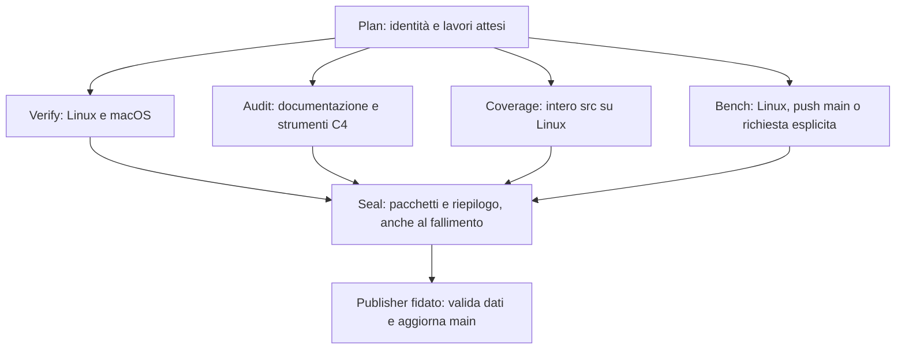

# CI e statistiche della versione corrente

> **Proposta — 2026-10-16.** Progetto implementabile; la CI attiva non viene
> sostituita da questo documento. Vincoli confermati dall'autore: solo
> runner GitHub e risultati in una cartella di `main`, con commit automatici.
> Le prestazioni dei runner ospitati rimangono misure esplorative.

Il contratto è semplice: **ogni numero identifica esattamente il codice,
il metodo e l'ambiente che lo hanno prodotto**. Per una metrica mancante
si espone uno stato, mai uno zero o un risultato precedente.

Riferimenti: [registro delle prove](../valutazione/registro-delle-prove.md),
[benchmark](../13-benchmark.md), [raccolta C4](raccolta-comandi.md),
[ADR-0027](../adr/0027-dipendenze-e-test.md), REQ-VAL-001,
REQ-AFF-005 e REQ-AFF-012. Questo progetto riguarda strumenti C4;
non modifica i formati del database o gli stati dei requisiti.

## 1. Punto di partenza

Ricognizione del codice locale `8ebca63f8649908e1a23b758928fa9c5c4274b00`:

| Esistente | Conseguenza progettuale |
|---|---|
| `.github/workflows/ci.yml`: `make check` Linux/macOS, più job documentazione | Mantenere la verifica del prodotto sui due sistemi; eliminare esecuzioni duplicate dei controlli indipendenti dalla piattaforma |
| Azione locale SBCL 2.6.9, Linux con checksum; macOS via Homebrew aggiornato | Versione dichiarata uguale non significa installazione identica; fissare distribuzione, digest e ricetta anche su macOS |
| `record-command.lisp`: ambiente, argv, blob prima/dopo, output, esito | Riutilizzare il registro originale; aggiungere un percorso di uscita esplicito e metadata CI |
| ASDF elenca le suite, ciascuna possiede runner e registrazione propri | Introdurre un catalogo unico e un protocollo di risultati per test; nessun conteggio da righe `ok` |
| `run-spikes.lisp`: dieci esperimenti, risultati strutturati e fallimenti | Riutilizzare gli esperimenti; distinguere verifica, misura, modello e funzionalità non supportata |
| `foundation-coverage.lisp`: scope selezionati e HTML | Aggiungere una campagna completa sul codice attuale e un'uscita numerica; gli scope sovrapposti non vanno sommati |
| `get-resolver-coverage.lisp`: numeratori/denominatori e controlli dei mark | Riutilizzare controlli di unicità e riconciliazione nell'adattatore generale; mantenere il formato interno vincolato alla toolchain |
| Compressione, hash e collector C4 già presenti | Comporre questi strumenti; escludere cache e viste ricostruibili dall'archivio persistente |

Le vecchie campagne in `spikes/results/` sono evidenze storiche. Non sono
un database da cui estrarre i numeri della versione corrente.

## 2. Identità della versione

Ogni campagna conserva queste identità, senza sovrapporle:

| Campo | Significato |
|---|---|
| `tested_sha` | `git rev-parse HEAD` del checkout realmente compilato |
| `source_id` | SHA-256 dell'inventario canonico di tutti i file tracked, escluso **solo** `spikes/results/ci/` |
| `policy_id` | Digest del catalogo, della selezione delle prove e dei metodi di misura |
| `run_id`, `run_attempt`, `job_id`, `profile` | Identità dell'esecuzione e della sua eventuale ripetizione |
| `publisher_sha`, `publication_parent` | Solo nella ricevuta di pubblicazione: codice del publisher e parent del commit dei risultati; non fanno parte dell'identità della misura |

L'inventario del `source_id` contiene path, modo Git e blob, ordinati per
byte del path; codifica UTF-8 e framing con NUL fissati nella versione dello
schema, formato degli object ID dichiarato. Comprende test, corpus, Unicode,
ASDF, strumenti, workflow, documentazione e fixture storiche usate dai
controlli. Conservare l'inventario oltre al digest. Un file nuovo o eliminato
cambia l'identità; symlink e submodule richiedono una politica esplicita.

Il producer controlla identità e albero prima e dopo la prova; checkout
sporco o mutato rende il risultato non attribuibile. Nessun download o
generazione modifica gli ingressi: gli output vivono sotto `spikes/out/`
o nella directory temporanea del runner.

Nelle PR conservare anche `head_sha` e `base_sha`: per l'evento
`pull_request` il checkout predefinito prova il merge sintetico. Non
etichettare quelle misure come prova del solo head della PR.
Il `tested_sha` si verifica sul checkout, non si deduce dal nome del branch
o dal campo `head_sha` di un evento successivo.
([Semantica degli eventi GitHub](https://docs.github.com/en/actions/reference/workflows-and-actions/events-that-trigger-workflows#pull_request).)

### Commit automatici dei risultati

Se `A` contiene il codice misurato e `B` aggiunge soltanto i risultati,
`A` e `B` hanno lo stesso `source_id`; il record mantiene `tested_sha=A`.
La vista per `B` dice «sorgenti identici a quelli provati in A», senza
inventare una compilazione di `B`. Una modifica fuori dal prefisso escluso
impone nuove misure, anche se è soltanto documentazione: scelta conservativa.

Il prefisso escluso è esclusivamente dati. Nessun file ASDF, script o
configurazione può esservi caricato come codice. Il controllo degli archivi
CI è separato dal controllo delle fixture storiche: il nuovo archivio viene
verificato integralmente dal publisher prima della pubblicazione, senza
riesaminare ogni precedente run ad ogni commit del prodotto.

## 3. Due workflow, un solo catalogo



`ci.yml` produce prove con `contents: read`. Il catalogo è l'unica fonte
per suite, profili, piattaforme, metriche, unità, metodi e lavori attesi.
ASDF e CLI locale consumano lo stesso catalogo; una verifica rifiuta
suite mancanti, sconosciute o duplicate. Anche gli smoke test senza
registro hanno ID e adattatore espliciti.

| Job | Frequenza | Responsabilità | Timeout iniziale proposto |
|---|---|---|---:|
| `plan` | Ogni PR/push/richiesta | Identità, inventario statico, matrice attesa, profili | 10 min |
| `verify` Linux/macOS | Ogni PR/push/richiesta | Compilazione pulita senza warning, tutte le suite previste, controlli nativi | 30 min ciascuno |
| `audit` Linux | Ogni PR/push/richiesta | Lint e self-test, trace/link, strumenti C4, fixture storiche, dieci spike `--check` | 30 min |
| `coverage` Linux | Ogni PR/push/richiesta | Ricompilazione strumentata e prove dello stesso catalogo; denominatore completo `src/` | 30 min |
| `bench` Linux | Ogni push di codice in main; PR/manuale su richiesta | Profilo quantitativo limitato e seriale, senza strumentazione di copertura | 20 min |
| `seal` | Sempre, anche dopo errori dei producer | Confronto attesi/osservati, completezza, manifest e upload | 10 min |

Sono budget di progetto, da validare sui primi run. Timeout dei figli
inferiore a quello del job, con margine per terminazione, chiusura del
record e upload. Nessuna attesa o enumerazione senza tetto.

`make check` resta la verifica completa locale; i sottoinsiemi della CI
devono avere la stessa unione di obblighi. La separazione non elimina un
controllo oggi necessario. I test del prodotto che dipendono dal sistema
operativo restano su entrambe le piattaforme; copertura quantitativa e
misure esplorative iniziali sono esplicitamente Linux.

Job indipendenti in parallelo; benchmark in processi nuovi e in serie nella
propria VM. Nessuna misura prestazionale contemporanea a build, hashing,
copertura o compressione nella stessa VM. Niente retry automatico per
rendere verde un test intermittente: un rerun conserva un nuovo attempt.

Un PR aggiornato può cancellare il suo run precedente; il reconciler ne
conserva lo stato cancellato. I push su main non vengono cancellati per
lasciare posto a un nuovo SHA. Non usare una concurrency globale del
publisher come coda affidabile: le regole predefinite possono sostituire
run pending. ([Concorrenza GitHub](https://docs.github.com/en/actions/concepts/workflows-and-actions/concurrency).)

## 4. Quali statistiche

Il catalogo assegna a ogni metrica ID stabile, dominio, unità, metodo,
origine, disponibilità e profilo obbligatorio. «Tutte» significa che ogni
voce ha un valore attribuibile oppure una ragione esplicita di assenza.

| Famiglia | Dati registrati | Fonte autorevole |
|---|---|---|
| Codice | File/byte/righe fisiche per modulo e categoria; componenti ASDF; file orfani | Inventario Git dello SHA; lexer C4 per categorie, senza valutare le forme |
| Compilazione | Esito, warning/style-warning, secondi, byte FASL | Recorder e confine del compilatore |
| Test | Pianificati, avviati, passati, falliti, non eseguiti; durata e condizione per ID | Eventi del runner, non stdout |
| FI, concorrenza, modelli | Casi nominati, semi, worker, budget, esiti e rifiuti attesi | Parametri ed eventi espliciti del test; non dedotti dal suo nome |
| Mutazioni | Baseline, mutanti validi/non applicabili, compilazione, detected/survived/inconclusive | Protocollo dei figli; un worker morto non conta come mutante rilevato |
| Copertura | Numeratori e denominatori per file/modulo; righe, rami e forme SBCL; file non strumentati | SB-COVER e adattatore vincolato alla toolchain |
| Tracciabilità | Requisiti per stato/classe, riferimenti mancanti; collegamenti a prove effettivamente eseguite | Database requisiti e report del checker |
| Qualità C4 | Violazioni lint, link rotti, matrice incoerente, casi negativi riconosciuti | Checker con uscita strutturata |
| Memoria e GC | Byte consed, collezioni, tempo GC CPU/reale, memoria dei buffer, RSS dove osservabile | Finestra misurata dichiarata, contatori SBCL/OS |
| Prestazioni | Operazioni e byte, elapsed, throughput, campioni/istogrammi, quantili supportati | Harness del workload attuale |
| I/O | Byte letti/scritti, flush, latenza fsync, banda, queue depth dove osservabili | Contatori del confine I/O/harness con semantica e finestra dichiarate |
| CI | Durate, timeout, cancellazioni, fallimenti infrastrutturali, toolchain/image/CPU, tentativi | Record locali più metadata GitHub del run |
| Conservazione | Byte originali/compressi/nuovi, hash, file, crescita del prefisso CI e dell'object store | Manifest e misure Git/filesystem |

Righe fisiche non diventano complessità ciclomatica. Un requisito con
una citazione non diventa «verificato». Una funzione composta è un test;
casi parametrizzati e campioni sono contatori separati, dichiarati dal
producer. Un test eseguito su due OS rimane un ID distinto per ambiente,
senza raddoppiare il numero di test unici del progetto.

ID qualificato e provenienza della definizione vengono controllati durante
la registrazione: il solo registro finale non basta, perché `pushnew` o
una ridefinizione possono aver nascosto un duplicato. Adattatori espliciti
per liste di simboli, alist, smoke e verticale; conteggi di casi/scenari
separati. I campioni di una qualification o di una mutazione non aggiungono
test unici. Le campagne estese non selezionate restano `not-run`.

Ogni valore porta `status`, unità, scope, metodo/versione, ambiente,
campione e riferimento all'evidenza. Stati minimi: `measured`, `passed`,
`failed`, `not-run`, `cancelled`, `timed-out`, `unsupported`,
`not-implemented`, `budget-exhausted`, `invalid`, `missing`.
Valore assente = NIL con ragione; zero richiede una misura valida di zero.
Denominatore nullo = «non applicabile», mai 100%.
Denominatore sconosciuto = dato incompleto: non pubblicare una percentuale
globale completa usando soltanto i file dei quali il denominatore è noto.

Le metriche del motore non ancora implementate, come compaction completa
o workload end-to-end mancanti, sono visibili come `not-implemented`.
I risultati degli spike mantengono il proprio scope: SPK-07 non diventa
throughput del database e un contatore dei buffer non diventa RSS.

### Eventi dei test

Prima della compilazione si salva l'elenco atteso delle suite. Dopo il
caricamento si salva l'inventario effettivo degli ID registrati; ogni
esecuzione scrive `started` e poi un unico esito terminale. Un errore di
compilazione lascia le suite successive `not-run`, con il numero dei loro
test sconosciuto se non è stato ancora ricavato autorevolmente.

Scrittura progressiva e flush, confine per suite/processo; dopo una FI
globale o un danno al runner si termina quel processo. Nessun recupero
generico che continui in un'immagine Lisp compromessa per gonfiare il
conteggio dei test. Distinguere errori attesi dal test e failure del test.
Se rimane soltanto `started`, conservare quell'evento e aggiungere una
osservazione esterna di interruzione, distinta dall'esito del test.
La causa è sconosciuta se non provata: SIGKILL non dimostra da solo OOM.

Lo stdout che contiene un protocollo strutturato completo, come quello
degli spike, può restare un trasporto nel producer non privilegiato;
il conteggio non deriva mai da log umani. Una foglia spike incorporata
anche nel padre è la stessa esecuzione, non due misure. Migrare i marker
testuali dei figli di mutazione a esiti strutturati prima di contarli.

### Copertura

Una sola sessione completa per piattaforma selezionata, dopo reset dei
contatori successivo al load. File normalizzati relativamente alla root,
con blob dello SHA provato. Nessuna somma delle percentuali degli scope
storici, né somma dei numeratori Linux/macOS. Totali pesati sommando i
contatori su insiemi disgiunti; eventuale unione richiede ID dei punti
identici e compatibilità di tutti gli ingressi.

SBCL 2.6.9 esporta `sb-cover:lcov-report`: usarlo per un record machine
readable, preservando il dialetto effettivo `DA`/`BA`. Un parser LCOV che
si aspetta soltanto `BRDA` darebbe dati errati. Forme SBCL grezze tramite
un piccolo adattatore C4 versionato sulla toolchain; fallire esplicitamente
se il formato atteso cambia, senza interpretare lo stato opaco salvato.
Conservare LCOV originale e numeratori/denominatori; HTML è una vista
ricostruibile. ([Sorgente SBCL 2.6.9](https://github.com/sbcl/sbcl/blob/sbcl-2.6.9/contrib/sb-cover/cover.lisp).)

Ogni file di prodotto atteso compare anche se non caricato o non
strumentato: una mancanza non lo elimina dall'inventario dichiarato.
Se il denominatore del file è sconosciuto, anche la copertura globale è
incompleta; il rapporto dei soli contatori noti è etichettato come parziale.
Le forme non strumentabili sono elencate separatamente, senza inventarne
un conteggio di esecuzione. Le prove non compatibili con strumentazione e
i figli non strumentati hanno stato e motivo espliciti; copertura parziale
rimane parziale. Forme/rami SBCL e righe LCOV non sono MC/DC o qualifica C1.

La qualification fulltext oggi esclude prove di allocazione dal percorso
strumentato. Il catalogo deve elencarle per ID e verificarne l'esecuzione
normale dello stesso source-id; questa separazione non le elimina
dall'inventario del prodotto.

### Prestazioni sui runner GitHub

Profilo breve per ogni nuovo `source_id` di main: workload supportati
selezionati dal catalogo, seme/dataset e budget fissi, warmup, ripetizioni
e clock dichiarati. Profilo esteso soltanto su richiesta, sempre per SHA
esplicito. Una misura estesa di ieri non riempie la casella dell'oggi.

Pubblicare campioni e dispersione oltre alla sintesi; non ricavare P99.9
da pochi campioni. Comparazioni descrittive soltanto a parità di metodo,
workload, formato, budget, toolchain, architettura e tipo di runner.
Anche un confronto seriale base/head nella stessa VM resta esplorativo.
Nessun gate di regressione basato su percentuali temporali di questi runner.
Errori del workload, output invalido o misura mancante restano failure
del processo di raccolta, indipendenti dal valore della prestazione.

## 5. Toolchain e cache

Label esplicite iniziali: `ubuntu-24.04` x86-64 e `macos-15` arm64.
Non sono immagini immutabili: registrare anche image release, architettura,
CPU, RAM osservata, kernel, SBCL/ASDF, digest distribuzione e ricetta,
flag di compilazione, heap e contrib. Non usare la sola stringa `SBCL 2.6.9`
come chiave di compatibilità. Aggiornamenti mediante modifica deliberata
del lock e nuova campagna. ([Runner GitHub](https://docs.github.com/en/actions/reference/runners/github-hosted-runners).)

Setup unico per i job. Distribuzione verificata o build da sorgente con
digest, bootstrap e opzioni fissati anche su macOS; non dipendere dalla
formula Homebrew corrente. Cache ammessa per la sola toolchain verificata,
con chiave completa OS/architettura/image/ricetta/digest e separazione dei
livelli di fiducia. I producer ricompilano sempre il prodotto; cache
FASL propria per profilo, mai condivisa fra coverage, verify e benchmark.
Nessuna cache rende saltata una prova o fornisce le statistiche correnti.

## 6. Risultati versionati in main

```text
spikes/results/ci/
  README.md                         # ultima versione archiviata, identità esplicita
  index.lisp                        # catalogo e riferimenti ai run, paginabile
  by-source/<source-id>/
    runs/<run-id>/<attempt>/
      payloads/<job-id>/<digest>/... # pacchetti producer immutabili, raw e gzip
      collections/<collection-id>/
        summary.lisp                # dati numerici e stati, schema canonico
        report.md                   # vista generata dagli stessi dati
        manifest.lisp               # inventario chiuso, dimensioni e SHA-256
      publications/<receipt-id>.lisp # parent/publisher della pubblicazione
```

Gli ID dei path derivano da campi con grammatica stretta, non da titoli di
PR o nomi di test. Ogni run/attempt è immutabile. Nuovo tentativo = nuovo
percorso; stessa consegna e stesso hash = no-op; stessa identità con byte
diversi = rifiuto. Non scegliere il report per mtime o nome «più recente».

Una raccolta incompleta non occupa per sempre il percorso del run:
il recupero aggiunge i payload mancanti e una **nuova collection** nello
stesso attempt. Il collection-id dipende dall'insieme canonico di evidenze
e stati osservati; le vecchie raccolte restano immutabili. La selezione
per attempt avanza con nuove evidenze validate, senza regredire a un
sottoinsieme incompleto arrivato in ritardo. Rerun diversi non vengono
mescolati implicitamente. La ricevuta di pubblicazione è esterna al
pacchetto misurato: retry e consegne duplicate non ne cambiano il digest.

Il comando proposto `make ci-status` ricalcola l'identità di `HEAD`, cerca
solo risultati compatibili e stampa completezza e limiti. Per un codice
nuovo senza report risponde `pending`/`missing`; non ripiega sul precedente
verde. L'ultimo attempt, anche fallito, rimane distinto dall'ultimo riuscito.

Un Markdown statico non può sapere che nel frattempo il branch è avanzato.
Perciò l'indice dice **ultima versione archiviata**, con SHA/source-id e
data; la vista «codice corrente» è calcolata da `ci-status` e dal run CI
associato al nuovo SHA. Questa distinzione impedisce un falso «tutto verde».

### Completezza

Tre campi indipendenti: `collection_closed` indica che ogni voce attesa ha
uno stato terminale, anche missing; `metrics_complete` indica che tutte le
misure obbligatorie sono valide; `verification_passed` indica che le
verifiche obbligatorie sono superate. Un archivio chiuso può contenere
misure mancanti e prove fallite.
Se manca il piano, l'insieme atteso è sconosciuto: non si chiude una
raccolta considerando vuoto quell'insieme e non si certifica completezza.
Il piano stabilisce job, profili e metriche attesi; l'aggregatore confronta
gli osservati, rifiuta duplicati e versioni diverse, non completa per
inferenza. Un job assente, un upload fallito, un setup interrotto o un
artefatto scaduto producono una riga esplicita di mancanza.

Un run passato senza output richiesto non è una raccolta completa. Un
benchmark fuori profilo non è una failure di correttezza, ma resta
`not-run` nella matrice quantitativa. Cancellazione/OOM possono impedire
`always()`: metadata esterni del run e recupero successivo colmano solo
lo **stato mancante**, senza inventare l'output che non esiste.

## 7. Publisher fidato e commit automatici

`ci-results.yml` usa `workflow_run: completed` sul solo workflow CI;
ha inoltre ingresso manuale e riconciliazione periodica dei run terminali.
Esegue codice C4 da uno SHA fissato del main fidato, mai codice scaricato
dai producer. Registra quel `publisher_sha` separatamente dal codice provato.
Il publisher dispone soltanto di `actions: read` e `contents: write`;
i producer non ricevono token di scrittura o segreti.

`workflow_run` è un confine privilegiato: verificare repository, workflow
ID, run/attempt, evento, artefatti e matrice attesi con metadata GitHub.
Non fidarsi di uno SHA o di un successo dichiarato soltanto nel payload.
I risultati PR sono archiviati come tali, non promossi a risultati main;
le conclusioni GitHub restano distinte dalle dichiarazioni del producer.
Hash e schema attestano integrità dei byte e coerenze verificabili;
non provano che numeri falsi ma coerentemente serializzati siano misure
corrette. Metodi, oracoli, codice dei producer e relativa revisione
restano parte dell'affidabilità della campagna.
([Confine workflow_run](https://docs.github.com/en/actions/reference/workflows-and-actions/events-that-trigger-workflows#workflow_run).)

Il trasporto è un manifest canonico piccolo: liste, keyword ammesse,
stringhe e interi limitati; quantità non intere come rapporto o decimale
con unità esplicita. Parser C4 dedicato con limiti di byte, profondità,
elementi e chiavi uniche; nessun dispatch reader `#`, package esterno,
costruttore, valutazione o codice. I record Lisp originali, anche compressi,
sono conservati come byte opachi; non vengono caricati dal publisher.
Il solo `*read-eval* NIL` non è il contratto sufficiente per questo confine.
Il collector esistente rimane nel producer non privilegiato; riusarne
hash/compressione non equivale ad autorizzare il suo reader su una PR.

Download in una root temporanea distinta dal checkout, manifest esplicito,
solo file regolari, path relativi ammessi, niente symlink, link fisici o
estrazione di archivi arbitrari. File, byte, hash e limite di espansione
verificati prima del commit; riepiloghi rigenerati con escaping dei campi.
Permessi di esecuzione vietati. Action esterne fissate a commit completi
verificati del repository ufficiale.
([Pinning delle action](https://docs.github.com/en/actions/reference/security/secure-use#using-third-party-actions).)

### Pubblicazione ottimistica, cinque tentativi

1. Leggere l'attuale main e costruire una nuova worktree Git privata da
   quel commit. Nessun checkout dei sorgenti PR nel job privilegiato.
2. Validare il pacchetto, aggiungere il percorso immutabile e ricalcolare
   l'indice rispetto al `source_id` del main appena letto.
3. Un risultato tardivo di A, mentre il codice è B, aggiunge lo storico
   di A. Non sostituisce lo stato di B. Ordinamento esplicito per run e
   attempt, senza preferire un vecchio successo a un fallimento recente.
4. Accertare che il diff tocchi soltanto `spikes/results/ci/`, con file
   regolari, budget rispettati e nessuna cancellazione o riscrittura di
   un run esistente. L'indice è l'unica vista aggiornata in luogo.
5. Verificare indipendentemente inventario e hash del nuovo pacchetto;
   aggiungere la ricevuta esterna, creare un commit il cui parent è il main
   letto e fare push normale. Il commit risultante è identificato dal ref
   e dai metadata GitHub, senza un hash autoreferenziale nel suo contenuto.
6. Se il push è non-fast-forward, ripartire dal nuovo main e rigenerare
   soltanto i metadati derivati; pacchetto invariato. Dopo cinque conflitti
   conservare lo stato `publication-pending`; niente force-push.

L'aggiornamento del ref Git pubblica atomicamente dati e indice. Non si
promette una transazione durevole del filesystem del runner.
Il commit è prodotto con `GITHUB_TOKEN`: i suoi eventi push non avviano
una nuova CI. Nessun PAT, commit message `[skip ci]` o copia di status
check da uno SHA ad un altro per simulare una prova.
([Semantica GITHUB_TOKEN](https://docs.github.com/en/actions/concepts/security/github_token#when-github_token-triggers-workflow-runs).)

Il 2026-10-16 le API del repository restituivano main non protetta e nessuna
regola applicabile. Questa osservazione non autorizza bypass futuri:
se una policy impedisce il push, il publisher fallisce esplicitamente e
lascia il pacchetto recuperabile. L'attivazione deve verificare anche i
permessi Actions effettivi; non modificare silenziosamente le protezioni.

### Recupero

La stessa logica di ingestione riceve run espliciti oppure enumera i run
terminali e gli attempt ancora incompleti, con paginazione e budget.
Avanzamento e recuperabilità sono per `(run_id, run_attempt)`, non per il
solo run. Proposta iniziale: riconciliazione ogni sei ore, finestra di
14 giorni, massimo 100 attempt per invocazione e cursore persistito.
Finestra incompleta, lacuna fuori finestra o budget finito sono visibili.
Nessuna dipendenza dall'ordine di arrivo di `workflow_run`.
Rileggere i metadata per l'attempt richiesto; non raccogliere dati del rerun
sbagliato. Un artefatto assente/scaduto resta `missing` con run URL.

Artefatti GitHub con nome comprendente SHA/run/attempt/job, upload anche
nei fallimenti recuperabili e retention iniziale di 30 giorni. Sono il
trasporto e il recupero; il risultato pubblicato risiede in main.
Verificare la retention effettiva: deve superare finestra, intervallo di
scansione e ritardo massimo ammesso, inizialmente sette giorni. Se le
policy la riducono, la configurazione è incompatibile; non ignorare la
scadenza. Un fermo oltre il margine richiede backfill esplicito o missing.
Gli artefatti v4 sono immutabili: ogni attempt ha identità propria.
([Artefatti e retention](https://docs.github.com/en/actions/tutorials/store-and-share-data).)

## 8. Spazio sotto controllo

Solo risultati, originali e ingressi non ricostruibili; niente checkout,
FASL, core, dataset rigenerabile, stato opaco SBCL o HTML per ogni file.
Conservare invece LCOV e contatori, semi, metodi e blob necessari a
ricostruire le viste. Compressione lossless prima del commit, original size
e SHA-256 registrati; il parser dei dati canonici non interpreta i raw.

Budget iniziali proposti, da validare sulla prima campagna completa:

| Oggetto | Tetto |
|---|---:|
| Riepilogo canonico | 64 KiB |
| Pacchetto persistente di un run, compresso | 2 MiB |
| Manifest e inventario di un run | 10.000 file, profondità 16 |
| Espansione/estrazione aggregata di un run | 256 MiB, contati progressivamente prima di allocare o scrivere oltre soglia |
| File ordinario / gzip / espansione | 1 MiB / 8 MiB / 128 MiB; prevale il budget più restrittivo |
| Prefisso CI corrente | Avviso a 128 MiB; blocco dei nuovi payload a 256 MiB |

Sforamento = failure di conservazione, con marker piccolo e link al run;
non troncare l'output per rientrare nel budget e non dichiarare la raccolta
completa. Dati identici hanno identità di contenuto e non vanno ricopiati
in più viste. Il registro contiene anche il costo dei commit automatici.

La storia Git cresce conservando i risultati. Eliminare una cartella
dall'ultimo commit non libera gli oggetti storici. Compressione e limiti
contengono la crescita; non danno una garanzia di spazio costante con
conservazione perpetua. Nessuna riscrittura automatica della storia o
eliminazione silenziosa di prove. Le soglie impongono una decisione esplicita
prima di un'ulteriore crescita; anche i marker hanno un budget complessivo.

## 9. Realizzazione e criteri di accettazione

Un entry point Common Lisp `tools/ci.lisp`, con sottocomandi `plan`, `run`,
`seal`, `ingest`, `status`, `reconcile`; moduli interni piccoli per catalogo,
record, copertura e pubblicazione. YAML limitato a trigger, dipendenze,
permessi, runner e invocazioni. Nessun secondo stack di scripting per le
statistiche; API e shell sono trasporto, non fonte dei conteggi.

Ordine di consegna:

1. Catalogo e identità, protocollo dei test/checker, normalizzazione e
   `ci-status` offline, con fixture per ogni stato mancante/fallito.
2. Producer verify/audit/coverage e benchmark limitati; prova dei budget
   reali di entrambi i sistemi, recupero di errori setup/OOM/timeout.
3. Publisher inizialmente in modalità dry-run: prima una campagna chiusa e
   revisionata, poi commit automatici nel solo prefisso autorizzato.
4. Riconciliazione, test delle corse Git e verifica di un ciclo completo
   codice → CI → commit risultati → risoluzione corretta sul nuovo HEAD.

| Caso obbligatorio | Risultato atteso |
|---|---|
| Nuovo SHA senza report | Pending/missing, nessun precedente verde presentato come attuale |
| Commit che aggiunge soltanto report | Source-id uguale, tested-sha originale conservato, nessuna CI ricorsiva |
| Modifica di test, corpus, workflow o toolchain | Identità/metodo cambiano, nessun riuso improprio |
| PR head diverso dal merge provato | Entrambe le identità conservate; attribuzione al tested-sha reale |
| Un test fallisce, altri non partono | Failure e not-run distinti, denominatori non inventati |
| Setup/OOM/cancellazione/upload fallito | Raccolta incompleta e causa esterna visibili |
| Rerun parziale | Attempt separati; nessun mosaico implicito fra tentativi |
| Coverage senza un file o con scope sovrapposti | Mancanza/duplicato rilevato; niente percentuale gonfiata |
| LCOV con BA, ramo mai preso, denominatore zero | Contatori esatti e N/A dove applicabile |
| Benchmark unsupported/budget esaurito | Stato esplicito, mai zero throughput |
| Due publisher o main che avanza | Entrambi i run archiviati o publication-pending; nessun overwrite/force-push |
| Evento duplicato o vecchio verde dopo nuovo rosso | No-op o storico; ultimo esito preservato |
| Missing seguito da recupero dei payload | Nuova collection nello stesso attempt; storico immutato e nessuna regressione a un sottoinsieme tardivo |
| Payload con dispatch Lisp, path escape, symlink o gzip eccessivo | Rifiuto prima di interpretazione privilegiata o commit |
| Protezione branch o quota impediscono la pubblicazione | Failure dichiarata; pacchetto recuperabile, niente bypass |
| Payload alterato rispetto al manifest o raw non corrispondente | Hash/schema rifiutati; conclusione CI non sostituita dal payload |

Prima dell'attivazione: self-test C4 strutturati anche per i rifiuti,
dry-run su un repository di prova, revisione indipendente e prova su
runner GitHub. I controlli locali di questo documento verificano soltanto
link e tracciabilità; non sono una campagna CI eseguita.

## 10. Revisione di questo progetto

Arendt ha esaminato fonti, registri e denominatori; Planck ha esaminato
pubblicazione e recupero. Entrambi hanno lavorato in sola lettura.
Sette rilievi recepiti: denominatore sconosciuto, interruzioni senza esito
del producer, limiti degli hash, nuove collection per recuperi, ricevuta
esterna alla misura, cursore per attempt con margine di retention e budget
aggregato di espansione. Rilettura delle correzioni del coordinatore;
nessuna prova di una pipeline attivata viene dedotta dalla revisione.

## 11. Implementazione e verifica locale — 2026-10-17

Disponibili `tools/ci.lisp`, il catalogo condiviso delle suite di prodotto, i due
workflow e la toolchain fissata. Il publisher valida dati inerti, unisce i
payload dello stesso attempt e pubblica con normali push e retry. Il recupero
mantiene un cursore per run/attempt. Il limite di 2 MiB comprende payload,
raccolte e ricevute dell'attempt; 2 MiB dei 256 MiB del deposito sono riservati
ai metadata di recupero. Un superamento resta un errore dichiarato.

La baseline del ramo CI, prima dell'integrazione delle nuove suite cache e
riserve full text, conserva questi
[report e originali locali](https://github.com/gpicchiarelli/ArcDocDB/blob/13c2eec90a7a80f97f3bd9ded6b62abd75b7cf78/spikes/results/2026-10-17-ci-implementazione/report.md):

- 315 controlli degli strumenti superati, con fixture positive e negative;
- compilazione e test del prodotto senza avvisi; il nuovo runner registra
  2.026 casi superati, zero fallimenti e zero casi saltati;
- piano e pacchetto verificati sull'inventario completo del repository;
- cinque repliche seriali del profilo CRC32C/UTF-8 completate; il budget di
  misura usa l'identità fornita e verificata dal coordinatore prima/dopo il job;
- sette controlli del publisher su un remoto Git bare privato, più un
  conflitto iniettato: retry riuscito e sorgente concorrente conservato.

Ogni risultato conserva il proprio SHA e metodo; questi esiti non sono
misure di un futuro merge. Le righe fisiche dell'inventario comprendono
documenti, dati ed evidenze storiche, anche binarie: non equivalgono a LOC
eseguibili. I moduli `src/*` rimangono distinti. Per i soli file untracked
sono ammesse anche le cache `spikes/SPK-*/out/` enumerate dal codice, incluso SPK-11;
ogni altro file tracked viene comunque verificato byte per byte.

Restano da verificare sui runner GitHub: installazione fissata, copertura
Linux, trasporto degli artifact e pubblicazione con il token del workflow.
Le fixture Git locali non certificano permessi o protezioni del repository
GitHub. In accordo con la richiesta del coordinatore, questo lavoro viene
lasciato committato nel worktree; integrazione e push spettano al coordinatore.

La raccolta locale usa il collector comune e quattro worker: 19 registri di
comando, 136 file indicizzati e inventario chiuso di 138 file, con controllo
indipendente. Le [osservazioni della raccolta](https://github.com/gpicchiarelli/ArcDocDB/blob/13c2eec90a7a80f97f3bd9ded6b62abd75b7cf78/spikes/results/2026-10-17-ci-implementazione-raccolta/collection/report.lisp)
e i [conteggi autorevoli](https://github.com/gpicchiarelli/ArcDocDB/blob/13c2eec90a7a80f97f3bd9ded6b62abd75b7cf78/spikes/results/2026-10-17-ci-implementazione-raccolta/counts.lisp)
sono conservati separatamente, senza append all'archivio chiuso. È registrato
anche un errore nel solo display del preparatore; il manifesto completo e
gli inventari del collector non sono stati troncati.

Il composto in `main` gestito dal coordinatore include altre suite e SPK-11:
le prove locali qui citate restano quelle dei rispettivi SHA. Catalogo,
aspettative numeriche dei self-test e lista delle cache devono essere
allineati e nuovamente verificati sul composto, senza riattribuire questi
risultati alla versione integrata.

## 12. Attribuzione degli esiti anche sui timeout

Il catalogo inizializza `:source` e `:condition` nelle righe dei casi prima
di aggiornarle. Aggiungere una chiave assente con `SETF GETF` al solo binding
locale del ciclo perdeva la provenienza o la diagnosi nello snapshot finale.
I confini del caso, della suite e del child CI intercettano ora
`SERIOUS-CONDITION`: `SB-EXT:TIMEOUT` non appartiene a `ERROR` e prima
sfuggiva alla registrazione, lasciando il rapporto in stato `:running`.

Un timeout del caso produce riga ed evento `:failed`; la suite si arresta
e i casi successivi conservano `:not-run` con motivo `:runner-stopped`.
Un timeout prima dell'ingresso in un caso fallisce la suite senza inventare
un caso eseguito. Senza destinazione del rapporto, ASDF continua a ricevere
un errore. Il confine child conserva il fallback fallito quando manca il
risultato, con uscita 1 e diagnosi. Non introduce retry dei test.

Le nove regressioni C4 in `tools/ci/conditions-self-test.lisp` iniettano
oggetti `SB-EXT:TIMEOUT`, senza sleep né dipendenza dallo scheduler. Sei
casi sono negativi. Verificano conteggi, provenienza, diagnosi, eventi,
snapshot persistiti, arresto dei corpi successivi e ripristino del delegato
child della fixture. Non misurano la precisione delle scadenze reali.

Sulla base `a91896bd` la prima fixture si è fermata prima dei casi per un
nome locale che collidiva con `CL:DIRECTORY`; originale e registro sono
conservati. Dopo la correzione della fixture, il codice precedente passa
2 casi e ne fallisce 7. La sola riparazione della provenienza porta a
3 passati e 6 falliti, isolando la perdita della diagnosi. La correzione
completa passa 9/9; l'autocontrollo CI passa 327/327 nei sei moduli.
Questi conteggi appartengono al ramo locale verificato, prima degli
ulteriori merge full text/recovery del coordinatore.

Il [catalogo dei registri e degli originali](https://github.com/gpicchiarelli/ArcDocDB/blob/13c2eec90a7a80f97f3bd9ded6b62abd75b7cf78/spikes/results/2026-10-17-ci-serious-conditions/catalogo.lisp)
conserva anche i tentativi falliti. Il codice è committato in `c7caed5f`;
verifica completa della composizione, integrazione e push restano al
coordinatore della chiusura.

## Rapporti nei processi freschi

La [provenienza dei merge PR](ci-provenienza-pr.md) distingue SHA del checkout,
head esposta da GitHub ed equivalenza dei contenuti con un merge associato
alla PR. La prova viene conservata senza promuovere il livello del producer.

La [regressione del wire isolato](ci-wire-processi.md) verifica che un rapporto
ordinario del producer sia leggibile caricando soltanto il modulo DATA,
senza keyword rese note incidentalmente da altri moduli o dal prodotto.
L'esito di seal resta distinto: conserva raccolte incomplete e restituisce
fallimento quando una verifica manca o fallisce.

Il risultato compatto di coverage espone EXPECTED-FILES come conteggio;
TOTALS conserva i denominatori. Le righe con percorso e blob restano nel
piano e nel rapporto raw, inclusi nel pacchetto verificato. Questo evita
che sealed duplichi l'inventario oltre il limite di 64 KiB. Prove ordinarie,
file mancanti e stato dei test restano integralmente nel risultato compatto.
Il conteggio deriva da TOTALS: un rapporto assente mantiene NIL, un
inventario misurato vuoto mantiene zero. La compattazione non ricava
uno zero dall'assenza dell'elenco.
